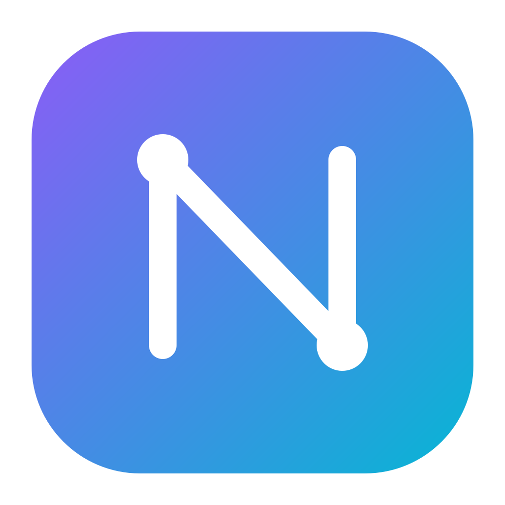
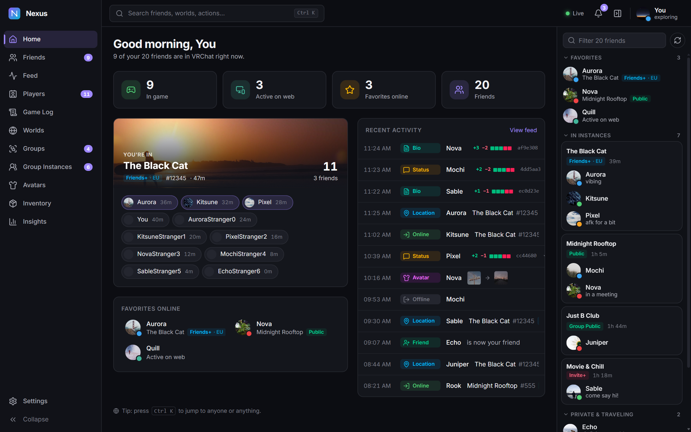
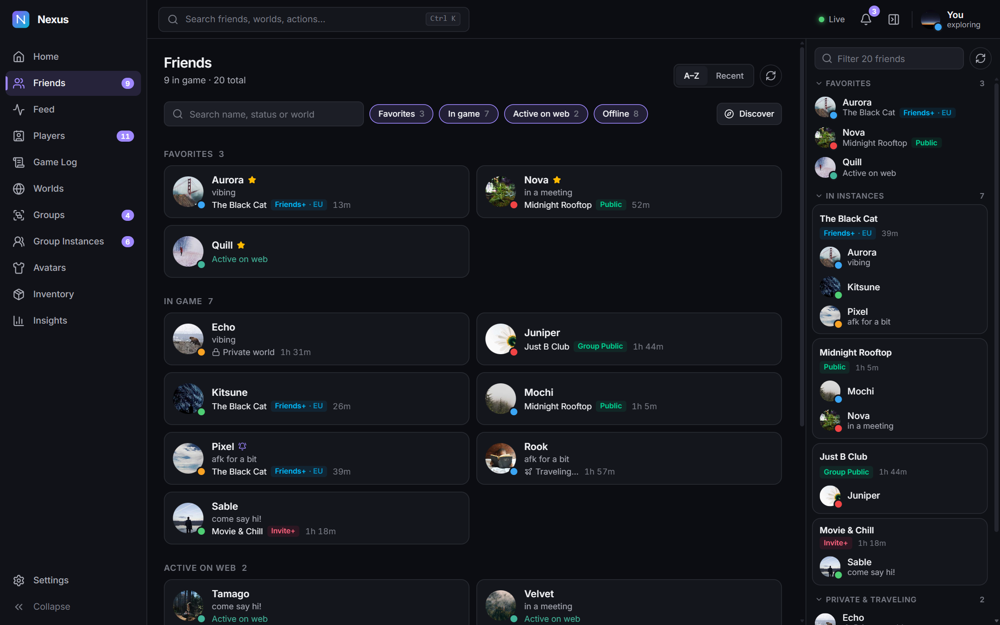
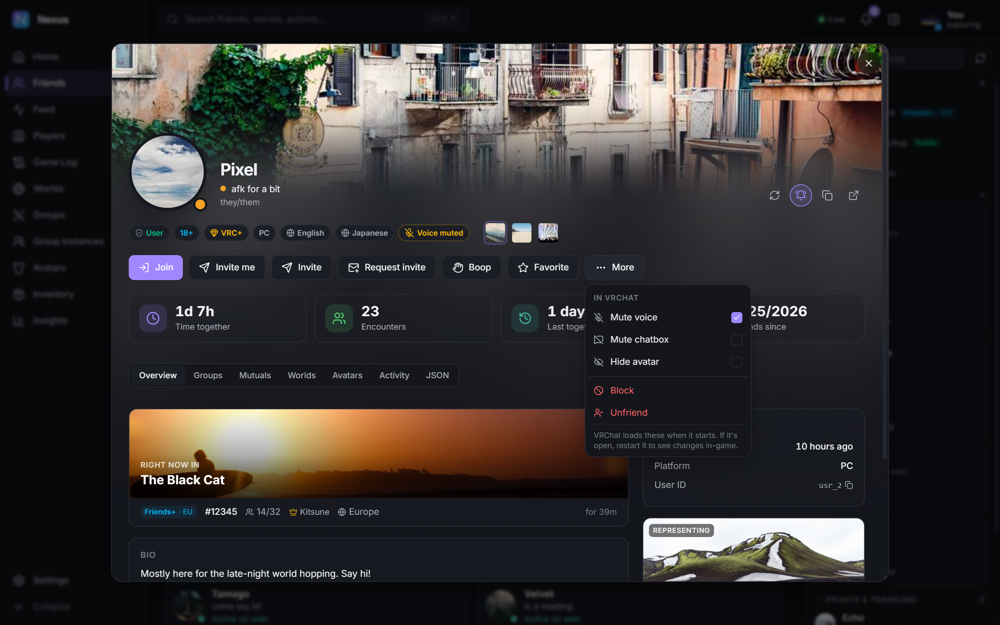
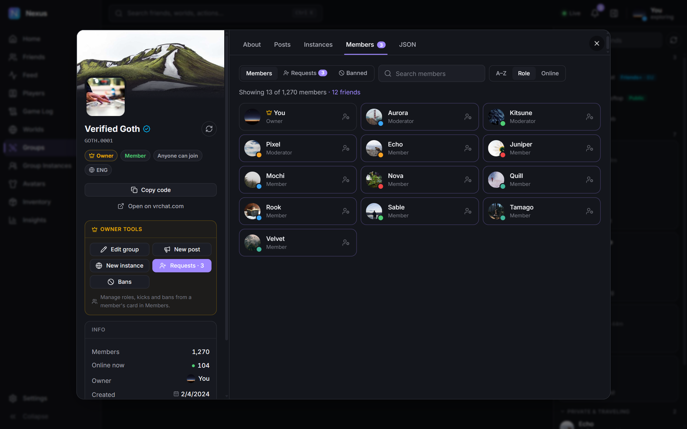
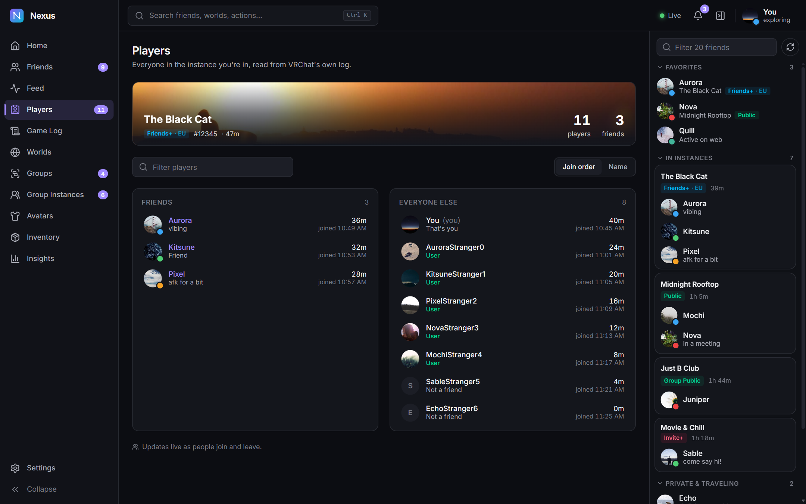
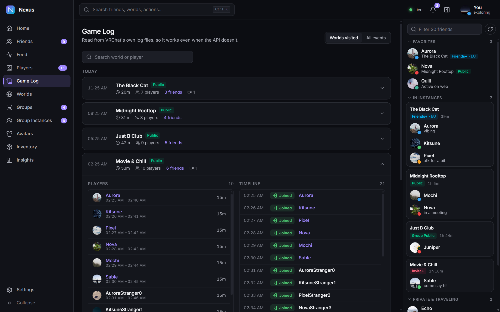
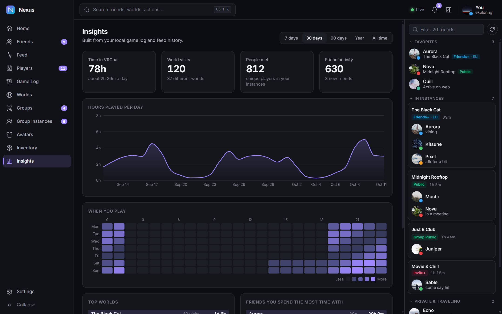
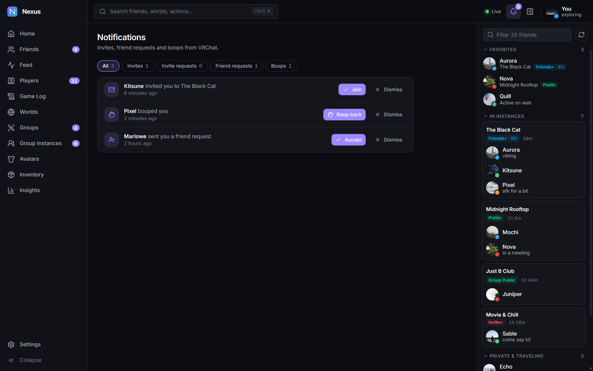
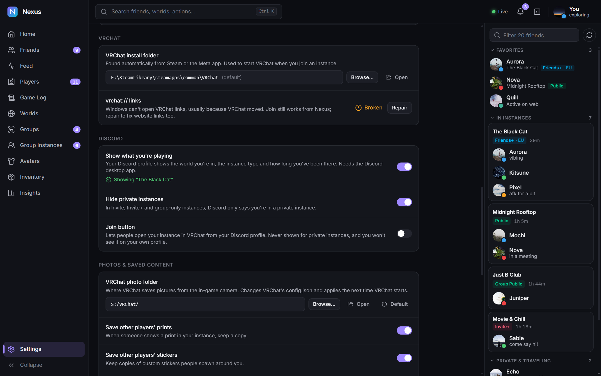

<div align="center">



# Nexus

**A fast, modern VRChat companion for Windows.**
See your friends live, keep a searchable history of everything that happens, run your groups and manage the people you meet, all from one small app. Everything Nexus records stays private and encrypted on your PC.

[](https://github.com/LunoviaVR/Nexus/releases/latest)
[](https://github.com/LunoviaVR/Nexus/releases)

[](LICENSE)

[Download](https://github.com/LunoviaVR/Nexus/releases/latest) · [What's new](https://github.com/LunoviaVR/Nexus/releases) · [Features](#-features) · [Privacy](#-privacy--your-data) · [Build from source](#-building-from-source)

<br />



</div>

---

## 💡 What is Nexus?

Nexus is a desktop app that runs next to VRChat. It signs in with your VRChat account, listens to VRChat's live connection for friend updates, and reads VRChat's own log files to know which worlds you visit and who you meet. Everything it sees becomes a history you can search, with stats on how you play. It also lets you do most things you'd otherwise open the VRChat website for: managing friends, groups, avatars, your profile and your inventory.

It's built with [Tauri 2](https://tauri.app) (a Rust core with a React interface), so it's light: the installer is about 6 MB and it uses your system's built-in WebView. Nexus has no servers of its own. Your history never leaves your PC.

## ✨ Features

### 👥 Friends & people

- **Live friends list.** Status and location changes arrive the moment they happen. Friends are grouped by the instance they're in (or by status), with your favorites on top, and sections for In game, Active on web and Offline.
- **One click from anywhere.** Join, Invite me, Invite or Request invite straight from the friends panel on every page.
- **Search VRChat** for people and worlds, and send friend requests to anyone you find.
- **Friend alerts:** ring the bell on a friend's profile to get a Windows notification when they come online or go offline.

### 🪪 Profiles

- A full-width banner that fades into the page, with **time together, encounters, last together and friends since** at a glance. On your own profile: play time, sessions, VRChat Credits and your join date.
- **Where they are right now**, including how full the instance is and who opened it.
- Bio and links, your VRChat **note**, and a private **memo** that never leaves your PC.
- Tabs for **Groups, Mutuals** (friends and groups), **Worlds, Avatars** (what you've seen them wearing), **Activity** (click an encounter to open that session in the Game Log) and the raw **JSON**.
- **Owned groups** on the overview: the groups this person runs.
- **Mute, hide, block, unfriend.** The **More** menu mutes someone's voice or chatbox, hides their avatar, blocks or unfriends them. Badges show what you've set, like **Voice muted** or **Blocked**. These are your real VRChat settings and apply in-game; hidden avatars are saved right into VRChat's own settings file on your PC.
- **Edit your own profile:** picture, bio, pronouns, links, languages, icon frame, nameplate and profile effects, showcased badges and represented group. Change your status from the top bar, and toggle account settings (avatar cloning, booping, mobile invites, mutuals and Discord visibility) right on your profile.
- **Boop** with any of VRChat's emojis, or your own.

### 📜 Feed, Game Log & Players

- **Feed:** every online/offline, location, status, avatar, bio and friend/unfriend change, searchable, filterable by type, or narrowed to your favorites.
- **Game Log:** read straight from VRChat's log files, so it works even when VRChat's API doesn't. Each world visit becomes a session with a tidy **player list** (how long each person stayed, rejoins merged) and a **timeline** of joins, leaves and videos.
- **Players:** everyone in your current instance with their picture and trust rank, friends first, updating live as people come and go, plus who recently left.
- **Save prints and stickers** other players show in your instance, sorted by month into a folder you choose.
- Nexus notices when VRChat quits or crashes, so it never shows you in a world you've already left.

### 🏘️ Groups

- All your groups, with search, sorting by name, members or members online, and an **Owned** filter. The same view is on every profile's Groups tab.
- **Discover** groups to join or request to join, and see each group's posts, instances, members and roles.
- **Group Instances:** every open instance across your groups, sorted by players or friends, filtered by access, region, platform, full and 18+.
- **Owner tools** for groups you run:
  - **Edit** the name, description, rules, links, languages, who can join, and the icon and banner (from your VRC+ icons and gallery, or upload new ones).
  - **Post announcements** to members, certain roles or everyone, with or without a notification, and delete old posts.
  - **Open group instances** in any world with your choice of access, region, queue and 18+, and **close** them, optionally sending everyone home.
  - **Answer join requests** (accept, decline, or decline and block).
  - **Manage members:** see each member's roles and what they're allowed to do, give or take roles, kick, ban and unban.
- Moderators of someone else's group get the tools their role allows.

### 🌍 Worlds & avatars

- **Worlds:** popular, recent, favorite and your own worlds, plus VRChat search. Open a world to see its instances, who opened each one, which friends are inside, and join or invite yourself, or start a new instance: public, friends, invite or one of your groups'. Click a creator to see all their worlds.
- **Avatars:** switch to your own avatars or any of your favorite lists, and add or remove favorites.
- **Avatar discover:** search public avatars by name, author or tags through the community index [avtrDB](https://avtrdb.com), with platform and performance filters.

### 🖼️ Inventory

- Your **prints, emojis, icons and banners**: view full size, download, set as your profile picture, upload new ones (VRC+) and delete.

### 🔔 Notifications

- Invites, invite requests, friend requests and boops behind the bell in the top bar, filterable by type, with Accept, Join, Invite back, **Boop back** and Dismiss.
- **Windows notifications** with a switch for each kind: friends coming online, going offline or joining your instance, invites, invite requests, boops, friend requests, new friends and unfriends.

### 🎧 Discord status

- Your Discord profile can show the world you're in with its picture, the instance type and region, who's hosting, how full it is and how long you've been there. **Off until you turn it on.**
- Private instances stay hidden by default, and an optional **Join** button lets people follow you into public ones.

### 📊 Insights

- Hours played per day, a **when-you-play heatmap**, your top worlds and the friends you spend the most time with, from the last 7 days to all time.

### ⚡ Quality of life

- **Ctrl + K** command palette to jump to any friend, world, group or page.
- Dark, **OLED** (true black) and light themes, and an accent colour from red through violet. Both are remembered across restarts.
- **VRChat's status** in the top bar: **Stable** when everything works, or what's wrong (degraded, an outage, maintenance) the moment status.vrchat.com reports it. Click it to open the status page.
- **What's new** behind the megaphone in the top bar: release notes for every version, right in the app. After an update, Nexus shows what changed once.
- Tray icon with a status switcher, close to tray, and start with Windows.
- Multiple VRChat accounts with quick switching, and two-factor sign-in.
- CSV export of your feed, game log, worlds and friends.
- Finds your VRChat install on its own (Steam or the Meta app), so **Join** starts VRChat even when Windows' `vrchat://` links are broken, and repairs those links in one click.
- Change VRChat's photo folder from Nexus.
- **Signed automatic updates**.

### 🐢 Gentle on VRChat

Nexus paces every request it makes so it doesn't get your account rate limited. What you click (invites, boops, edits) always goes first, then whatever you're looking at, and background work only uses what's left. If VRChat asks it to slow down, everything waits as long as VRChat asks, and you see how long instead of an error. Identical requests made at the same moment share one call. Things VRChat says don't exist or are private aren't asked about again for 15 minutes. Once your session expires, Nexus stops sending requests until it has signed you back in.

## 📸 Screenshots

| | |
|---|---|
|  |  |
| **Friends:** live status and location, grouped and searchable | **Profiles:** time together, where they are right now, and mute, hide, block or unfriend |
|  |  |
| **Groups:** owner tools, join requests, roles and members | **Players:** everyone in your instance, live, with pictures |
|  |  |
| **Game Log:** who was there, for how long, and what happened | **Insights:** hours played, when you play, top worlds and friends |
|  |  |
| **Notifications:** invites, friend requests and boops, filterable | **Settings:** VRChat install, Discord status, saved prints and stickers |

<sub>Screenshots use Nexus's built-in demo data; the names and pictures are made up.</sub>

## 📥 Install

1. Download **`Nexus_x.y.z_x64-setup.exe`** from the [latest release](https://github.com/LunoviaVR/Nexus/releases/latest).
2. Run it. It installs for your user only, with no admin rights needed.
3. Sign in with your VRChat account. Two-factor authentication is supported.

> **"Windows protected your PC"?** The installer isn't code-signed with a paid certificate yet, so SmartScreen may warn the first time. Click **More info → Run anyway**. Updates are still cryptographically signed and verified by Nexus itself.

**Requirements:** Windows 10 or 11 (64-bit) with the WebView2 runtime, which ships with Windows 11 and is installed automatically on Windows 10 if it's missing.

### Updating

Nexus checks for a new release when it starts and every 30 minutes, then offers it in a notification: click **Install & restart**. You can also check in **Settings → Updates**. Every update is signed, and Nexus refuses anything that doesn't match its built-in public key.

## 🔁 Moving from VRCX

Open **Settings → Data → Import from VRCX** and click **Import**. Nexus finds `%APPDATA%\VRCX\VRCX.sqlite3` on its own (or you can pick the file) and brings over:

- your friend feed (location, online/offline, status, avatar and bio changes, friends and unfriends),
- your game log (worlds, the people you were with, videos),
- "friends since" dates, and memos.

Only history from **before** Nexus started recording is imported, so nothing is doubled, and importing again is harmless. VRCX can stay open; its files are only read, from a temporary copy.

## 🔒 Privacy & your data

Nexus has no servers and no analytics or telemetry. It talks only to:

- **VRChat**, for everything about your account, friends, worlds, groups and avatars, and its status page ([status.vrchat.com](https://status.vrchat.com)) once a minute while Nexus is on screen, to show whether VRChat is having problems;
- **api.gxthgirls.tech** and **downloads.gxthgirls.tech**, to check for and download updates, with **GitHub** as a fallback. The update check sends only your Nexus version;
- **[avtrDB](https://avtrdb.com)**, only when you use Avatar discover;
- the **Discord app on your PC**, only if you turn on Discord status. Discord then shows the world you're in on your profile.

### What Nexus stores

| What | Where | Protected by |
|---|---|---|
| Your history: feed, game log, encounters, friend log, memos, settings, theme and accent color | `%APPDATA%\app.nexus.vrchat\nexus.db` | **SQLCipher** (AES-256) |
| Cached VRChat images | `%LOCALAPPDATA%\app.nexus.vrchat\images-enc\` | **AES-256-GCM**, keyed file names |
| Encryption key | Windows Credential Manager (`nexus-vrchat` / `database-key`) | Your Windows account |
| VRChat session, and your password only if you tick *Remember password* | Windows Credential Manager (`nexus-vrchat` / your user ID) | Your Windows account |
| Saved prints and stickers (if you turn it on) | `Pictures\Nexus` or the folder you choose | Plain image files, like VRChat's photos |
| UI preferences (sidebar, layout, and a copy of your theme so it shows instantly) | WebView storage in `%LOCALAPPDATA%\app.nexus.vrchat` | Nothing personal |

The encryption key is generated randomly on your PC the first time Nexus starts. Without it the database and image cache are unreadable, so other apps and anyone browsing your files only see scrambled data.

### VRChat's own files

Nexus only changes VRChat's files when you ask it to:

- **Hide avatar** writes to VRChat's show/hide list (`LocalLow\VRChat\VRChat\LocalPlayerModerations\`), because that's the only place VRChat keeps it.
- **Photo folder** in Settings edits VRChat's `config.json`.

Everything else, like mutes, blocks and profile edits, goes through VRChat's API like the website does.

### Your data, your call

- **Read it:** *Settings → Privacy → Export decrypted copy* saves a normal SQLite file wherever you choose, after a confirmation. That copy is **not** encrypted, so delete it when you're done.
- **Remove it:** uninstall Nexus, delete the two `app.nexus.vrchat` folders above, and remove the `nexus-vrchat` entries in *Control Panel → Credential Manager → Windows Credentials*.

> If the key in Credential Manager is ever deleted, the old database can't be decrypted. Nexus moves it aside (`nexus.db.unreadable-…`) and starts fresh rather than failing.

## 🛠️ Building from source

### Requirements

- **Windows 10/11** with the **Visual Studio C++ Build Tools** (the "Desktop development with C++" workload)
- **[Node.js](https://nodejs.org) 20+**
- **[Rust](https://rustup.rs) 1.82+** (stable, MSVC toolchain)
- **[Strawberry Perl](https://strawberryperl.com)**, needed to compile OpenSSL for SQLCipher:
  ```powershell
  winget install StrawberryPerl.StrawberryPerl
  ```
  Open a **new** terminal afterwards so it's on your `PATH`. If the build still picks up Git's Perl, set `PERL=C:\Strawberry\perl\bin\perl.exe`.

### Run

```bash
npm install
npm run tauri dev
```

`npm run tauri dev` opens the real app with hot reload: UI changes show instantly, and Rust changes rebuild and relaunch.

`npm run dev` on its own serves the UI in a normal browser with a **mock backend** (`src/lib/mock.ts`) full of demo data, which is handy for UI work without signing in.

### Test

```bash
npm run typecheck
npm test                      # locations, text, formatting, boops and friend lists (vitest)
cd src-tauri && cargo test    # log parser, database, encryption, VRCX import, request pacing, VRChat files
```

To exercise the game-log tailer without VRChat, point it at the fixture logs:

```bash
NEXUS_LOG_DIR=src-tauri/tests/fixtures npm run tauri dev
```

### Build an installer

```bash
npm run tauri build
```

Installers land in `src-tauri/target/release/bundle/`. Because the updater is enabled, a release build must be signed: set `TAURI_SIGNING_PRIVATE_KEY` to your updater private key (see below), or remove `createUpdaterArtifacts` from `src-tauri/tauri.conf.json` for an unsigned local build.

## 🚀 Releasing

Releases are built and published by GitHub Actions ([`.github/workflows/release.yml`](.github/workflows/release.yml)).

**One-time setup:**

1. Generate an updater signing key, and keep the private key safe and out of the repo:
   ```bash
   npx tauri signer generate -w ~/.tauri/nexus-updater.key
   ```
2. Put the public key (`nexus-updater.key.pub`) in `src-tauri/tauri.conf.json` → `plugins.updater.pubkey`.
3. In the GitHub repo, go to **Settings → Secrets and variables → Actions** and add:
   - `TAURI_SIGNING_PRIVATE_KEY`: the **contents** of `nexus-updater.key`
   - `TAURI_SIGNING_PRIVATE_KEY_PASSWORD`: its password (an empty value if none)

**Each release:**

1. Bump the version in `package.json`, `src-tauri/tauri.conf.json` and `src-tauri/Cargo.toml` (and `Cargo.lock`, which the next build updates).
2. Write the notes in `docs/releases/vX.Y.Z.md`; they become the release description.
3. Commit, then tag and push:
   ```bash
   git tag v1.2.3
   git push origin main --tags
   ```
4. The workflow tests, builds, signs and creates a **draft** release with the installer and `latest.json`. Review it and click **Publish**.
5. Publishing it runs `.github/workflows/publish.yml`, which sends the installer to Nexus's update server (`https://api.gxthgirls.tech/nexus`). The server checks the signature, stores it under `https://downloads.gxthgirls.tech/nexus/vX.Y.Z/` and points `latest.json` at it; the update toast shows the first bullet of the release notes. It needs no secrets: it signs in with GitHub's OIDC token, which the server accepts only from this repository's publish workflow. Installed copies pick the update up within 30 minutes.

**Built locally instead?** `npm run release -- --notes "One-line summary"` uploads the local build (with `NEXUS_PUBLISH_TOKEN` from `/srv/secrets/nexus-api.env` on the VPS in your environment) and writes `latest.github.json`; attach that to the GitHub release as `latest.json`. Add `--dry-run` to preview.

> ⚠️ Losing the private key means existing installs can no longer verify updates. Back it up somewhere safe.

## 🧭 How it works

```
React UI ──invoke──► Rust core (Tauri 2)
   ▲                   ├─ api.rs               VRChat REST: session cookies, one paced request scheduler, 429 recovery
   └──── events ────── ├─ pipeline.rs          VRChat websocket → friend, user and notification events
                       ├─ sync.rs              friend model, feed changes, Windows notifications, cached lookups
                       ├─ commands.rs          everything the UI can ask for: profiles, groups, worlds, avatars, moderation
                       ├─ gamelog.rs           tails output_log_*.txt; notices when VRChat quits or crashes
                       ├─ people.rs            names and pictures for players who aren't your friends
                       ├─ db.rs                SQLCipher database: feed, game log, presence, memos, cache
                       ├─ vault.rs             encryption keys (Credential Manager) and image-cache crypto
                       ├─ images.rs            nximg:// protocol with an encrypted on-disk image cache
                       ├─ ugc.rs               saves prints and stickers shown in your instance
                       ├─ discord.rs           Discord Rich Presence over Discord's local IPC pipe
                       ├─ avtrdb.rs            avatar discover through avtrDB
                       ├─ local_moderation.rs  VRChat's show/hide avatar list on your PC
                       ├─ vrc_launch.rs        finds the VRChat install and starts it for joins
                       ├─ vrc_config.rs        VRChat's config.json (photo folder)
                       ├─ vrcx.rs              one-click import from VRCX
                       └─ session.rs           VRChat session cookies in Windows Credential Manager
```

- **Frontend:** React 19, TypeScript, Tailwind CSS 4, TanStack Query, Zustand, Radix UI, Recharts.
- **Backend:** Rust, Tauri 2, rusqlite with SQLCipher, reqwest, tokio-tungstenite.
- VRChat asks API clients to send a descriptive `User-Agent`. Nexus sends `Nexus/<version> (+https://github.com/LunoviaVR/Nexus)` (see `src-tauri/src/api.rs`).

## ❓ Troubleshooting

- **The Game Log and Players page are empty:** VRChat's logging must be on (it is by default). If your logs live somewhere else, set the folder in **Settings → Behavior → VRChat log folder**.
- **A mute or hidden avatar doesn't show in-game:** VRChat loads these when it starts, so restart VRChat after changing them in Nexus. Until then, don't change anyone's avatar visibility inside VRChat, or it will overwrite what Nexus saved.
- **Join doesn't start VRChat, or links on vrchat.com stopped working:** check **Settings → VRChat**. Nexus shows the install it found and can repair VRChat's links.
- **"Your VRChat session expired":** sign in again. With *Remember password* ticked, Nexus can sign you back in on its own.
- **Uploads, icons or banners fail:** VRChat requires VRC+ for those.
- **Build fails configuring OpenSSL** (`Can't locate Locale/Maketext/Simple.pm` or `makefile wasn't produced`): Git's Perl is being used. Install Strawberry Perl and set `PERL=C:\Strawberry\perl\bin\perl.exe`.

## ⚖️ Disclaimer & license

Nexus is a fan-made project and is **not affiliated with, endorsed by or sponsored by VRChat Inc.** It uses the same unofficial API as other community tools such as VRCX, paces its requests and identifies itself properly. Use it responsibly and within [VRChat's Terms of Service](https://hello.vrchat.com/legal).

Nexus is free software under the [GNU General Public License v3.0](LICENSE).
